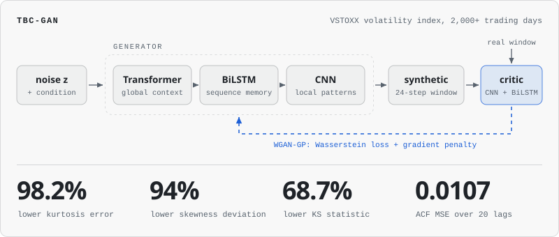
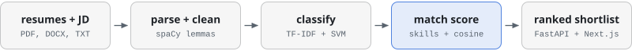

<!--
  Profile README for github.com/Yogdeep2004 (lives in the repo Yogdeep2004/Yogdeep2004).
  Every graphic is generated. To change one, edit scripts/build_assets.py and run:
      python3 scripts/build_assets.py
-->

<picture>
  <source media="(prefers-color-scheme: dark)" srcset="assets/header-dark.svg">
  
</picture>

  <a href="https://deepwork-systems.vercel.app/"><picture><source media="(prefers-color-scheme: dark)" srcset="assets/btn-portfolio-dark.svg"></picture></a>&nbsp;
  <a href="https://www.linkedin.com/in/yogdeep-benchimath-b61b9928a/"><picture><source media="(prefers-color-scheme: dark)" srcset="assets/btn-linkedin-dark.svg"></picture></a>&nbsp;
  <a href="https://drive.google.com/file/d/1BCY0wAVPWIlkri2drv9za_PuQ6MCot1X/view?usp=sharing"><picture><source media="(prefers-color-scheme: dark)" srcset="assets/btn-resume-dark.svg"></picture></a>&nbsp;
  <a href="mailto:yogdeep2004@gmail.com"><picture><source media="(prefers-color-scheme: dark)" srcset="assets/btn-email-dark.svg"></picture></a>

<picture>
  <source media="(prefers-color-scheme: dark)" srcset="assets/terminal-dark.svg">
  
</picture>

I study Artificial Intelligence and Machine Learning at VIT Vellore and build ML systems end to end: the model, the evaluation around it, and the service that ships it. My work sits in three areas: generative AI and deep learning for financial time series, NLP and semantic search, and computer vision at the edge.

I am most interested in problems where the data is messy and one headline metric is not enough, so I decide how a result will be measured before I decide what to train. That habit comes from applied AI work on driver-monitoring models, real-time face recognition and synthetic market data, where a model that looks right and a model that holds up are different things.

 

## Selected work

### `01` &nbsp;TBC-GAN

**Synthetic financial time series from a Transformer-based conditional GAN.** &nbsp;[`Financial_time_series →`](https://github.com/Yogdeep2004/Financial_time_series)

`TensorFlow` `Keras` `WGAN-GP` `Transformer` `BiLSTM` `CNN` `Optuna`

<picture>
  <source media="(prefers-color-scheme: dark)" srcset="assets/fig-tbcgan-dark.svg">
  
</picture>

A generator can match the histogram of real market data and still produce paths no market would trace. This project treats synthetic data as a statistics problem first: volatility clustering, heavy tails and long memory have to survive generation, or the scenarios are useless for risk work.

- **Problem.** Stress testing, portfolio simulation and strategy evaluation need many realistic scenarios, and history provides one. Forecasting models estimate the next value; they do not generate alternatives.
- **Architecture.** The generator stacks three views of one sequence: Transformer self-attention for global dependencies, a BiLSTM for temporal memory, a CNN for local structure. A CNN + BiLSTM critic is trained under WGAN-GP, with a TimeGAN-style embedder and supervisor adding a supervised signal. Hyperparameters are tuned with Optuna.
- **Evaluation.** Scored on distributional and temporal fidelity instead of point-wise error: KS statistic, skewness, kurtosis and autocorrelation across lags, on 8+ years of VSTOXX volatility data.
- **Result.** Against the baseline: **98.2%** lower kurtosis error, **94%** lower skewness deviation, **68.7%** lower KS statistic, and an ACF MSE of **0.0107** over 20 lags.

Implementation notes

 

- Training data is cut into 24-step sliding windows over min-max scaled index values.
- The critic takes 5 updates per generator step, with the gradient penalty computed on interpolated real and synthetic samples.
- The evaluation script also simulates an AR(2) reference process and compares density, autocorrelation and sample paths side by side.
- Results are explorable in a companion dashboard: [`volatility-insights`](https://github.com/Yogdeep2004/volatility-insights) (React, TypeScript, Recharts).

 

### `02` &nbsp;Hybrid semantic search

**Information retrieval over ~20,000 documents that routes, caches, recalls and re-ranks.** &nbsp;[`semantic-search-system →`](https://github.com/Yogdeep2004/semantic-search-system)

`Python` `sentence-transformers` `FAISS` `BM25` `Fuzzy C-Means` `FastAPI` `Docker`

<picture>
  <source media="(prefers-color-scheme: dark)" srcset="assets/flow-search-dark.svg">
  
</picture>

- **Problem.** Keyword search fails when the query and the document use different words for the same thing.
- **Approach.** Two-stage retrieval over the 20 Newsgroups corpus, behind a FastAPI service: BM25 recalls the top 100 candidates, then FAISS re-ranks them on MiniLM sentence embeddings, so natural-language queries match on meaning without giving up exact-term recall.
- **Decision.** Fuzzy c-means over hard clustering. Documents keep soft membership across 20 topics, which exposes boundary documents and lets the semantic cache be partitioned by cluster, so a lookup only compares against entries that could plausibly match.
- **Result.** A 42% cache hit rate at a 0.85 similarity threshold on a 50-query test set, with the trade-off measured from 0.75 (62%) to 0.90 (22%).

 

### `03` &nbsp;Resume Screening Assistant

**Applied NLP that classifies resumes and ranks them against a job description.** &nbsp;[`resume_screening_assistant →`](https://github.com/Yogdeep2004/resume_screening_assistant)

`Python` `scikit-learn` `spaCy` `TF-IDF` `SVM` `FastAPI` `Next.js` `Docker`

<picture>
  <source media="(prefers-color-scheme: dark)" srcset="assets/flow-resume-dark.svg">
  
</picture>

- **Problem.** Screening hundreds of resumes for one role by hand is slow and inconsistent.
- **Approach.** Resumes in PDF, DOCX or TXT are parsed and cleaned, a TF-IDF + SVM classifier predicts the job category, and each resume is scored against the job description and returned as a ranked shortlist with extracted keywords.
- **Decision.** The match score is a hybrid: 60% overlap on a curated skill ontology, 40% TF-IDF cosine similarity over lemmatised text. Skill overlap keeps the ranking explainable to a recruiter, and cosine similarity catches relevance the ontology does not list.

 

### `04` &nbsp;Consent Map

**Real-time face recognition with consent tracking, built at Samsung R&D.** &nbsp;[`consentmap-admin-portal →`](https://github.com/Yogdeep2004/consentmap-admin-portal)

`YOLOv8` `RetinaFace` `FAISS` `FastAPI` `React` `TypeScript`

<picture>
  <source media="(prefers-color-scheme: dark)" srcset="assets/flow-consent-dark.svg">
  
</picture>

- **Problem.** Recognising people in live video is only deployable when consent is tracked per identity and access to the data is controlled.
- **Approach.** Computer vision with YOLOv8 and RetinaFace, identity matching through FAISS vector search, and FastAPI services for PID assignment, detection, visualisation and confidence filtering.
- **Result.** About 95% recognition accuracy, managed through a role-based React and TypeScript admin portal (the public repository).

 

### More builds

| Project | What it is |
| --- | --- |
| [Campus&nbsp;Copilot](https://github.com/Yogdeep2004/campus-copilot) | Natural-language assistant for campus navigation, events and facilities. Team build, 1st place at an IEEE hackathon with 100+ teams. `React` `TypeScript` `FastAPI` |
| [Volatility&nbsp;Insights](https://github.com/Yogdeep2004/volatility-insights) | Interactive dashboard that makes the TBC-GAN research results explorable. `React` `TypeScript` `Recharts` |
| [AquaGuard&nbsp;AI](https://deepwork-systems.vercel.app/#work) | Edge AI water-risk detection over a LoRaWAN mesh with offline Coral TPU inference. Team build, selected for pre-incubation. `Python` `Coral TPU` `LoRaWAN` |

Earlier machine learning work

 

| Project | What it is |
| --- | --- |
| [Human&nbsp;Action&nbsp;Prediction](https://github.com/Yogdeep2004/Human_action_prediction) | Human activity recognition on the MHEALTH wearable-sensor dataset. KNN on scaled readings reaches 97% accuracy. `scikit-learn` |
| [Sentiment&nbsp;Analysis](https://github.com/Yogdeep2004/sentiment-analysis) | VADER against a Hugging Face transformer on product-review sentiment. `NLTK` `Transformers` |
| [Bike&nbsp;Sharing&nbsp;Demand](https://github.com/Yogdeep2004/Bike_sharing_demand_prediction) | Daily rental demand forecasting with RFE feature selection and a random forest, R2 of 0.90. `scikit-learn` |
| [Diabetes&nbsp;Prediction](https://github.com/Yogdeep2004/Diabetes_predict) | KNN, a decision tree and an MLP compared on the Pima diabetes data, with the overfitting made visible. `scikit-learn` |
| [neuralnet](https://github.com/Yogdeep2004/neuralnet) | First project on GitHub. `Python` |

[Browse all repositories →](https://github.com/Yogdeep2004?tab=repositories)

 

## How I work

<picture>
  <source media="(prefers-color-scheme: dark)" srcset="assets/method-dark.svg">
  
</picture>

Evaluation gets built before the system it judges. At EdgeTensor that meant scripts that scored dashcam models and reported where they failed, alongside the retraining and tuning that took smoking-event detection from about 65% to 96%.

 

## Experience

<table>
  <tr>
    <td valign="top"><b>2026</b> Feb&nbsp;to&nbsp;Jun</td>
    <td valign="top">
      <b>AI/ML Engineering Intern</b> &nbsp;at EdgeTensor, Plano, Texas 
      Edge AI for ADAS and driver monitoring (DMS). Tested dashcam-based models on event detection, built scripts that score model accuracy and generate automated reports with failure analysis, and raised smoking-event detection from about <b>65% to 96%</b> through additional training data and model and system tuning. Also built a pedestrian detection layer.
    </td>
  </tr>
  <tr>
    <td valign="top"><b>2025&#8209;26</b> Sep&nbsp;to&nbsp;Feb</td>
    <td valign="top">
      <b>Project Intern</b> &nbsp;at Samsung R&D, Bengaluru 
      Real-time consent mapping with YOLOv8, RetinaFace and FAISS vector search, FastAPI services, and a role-based admin interface in React and TypeScript.
    </td>
  </tr>
  <tr>
    <td valign="top"><b>2025</b> Jun&nbsp;to&nbsp;Jul</td>
    <td valign="top">
      <b>Machine Learning Intern</b> &nbsp;at Fox Trading, Bengaluru 
      Real-time human action detection with OpenCV and deep learning, and a diabetes prediction model evaluated on confusion matrix, F1 and ROC-AUC.
    </td>
  </tr>
  <tr>
    <td valign="top"><b>2024</b> Jun&nbsp;to&nbsp;Aug</td>
    <td valign="top">
      <b>Junior Backend Developer</b> &nbsp;at Fleetoperate, Manitoba, Canada 
      Driver-efficiency tracking and loss-prediction algorithms, secure authorization APIs and log retention systems, with an international engineering team.
    </td>
  </tr>
  <tr>
    <td valign="top"><b>Now</b></td>
    <td valign="top">
      <b>B.Tech, Artificial Intelligence and Machine Learning</b> &nbsp;at VIT Vellore
    </td>
  </tr>
</table>

 

## Toolkit

<table>
  <tr><td><b>Languages</b></td><td>Python, Java, C++, SQL</td></tr>
  <tr><td><b>Machine learning</b></td><td>PyTorch, TensorFlow, Keras, scikit-learn, Hugging Face, Optuna</td></tr>
  <tr><td><b>AI systems</b></td><td>LLM applications with LangChain and LangGraph, RAG, embeddings, vector search with FAISS</td></tr>
  <tr><td><b>Computer vision</b></td><td>OpenCV, YOLOv8, RetinaFace, edge AI for ADAS and DMS</td></tr>
  <tr><td><b>Backend and infrastructure</b></td><td>FastAPI, Streamlit, Docker, AWS, Google Cloud, Git</td></tr>
</table>

 

## Currently building

<!-- Three lines, edit freely. -->

`01` &nbsp;Improving the financial machine learning research pipeline behind TBC-GAN.

`02` &nbsp;Building stronger AI systems and retrieval applications.

`03` &nbsp;Preparing for production-grade ML engineering roles.

 

## Contact

Let's build something interesting. I am open to conversations about AI, machine learning, research and engineering.

[LinkedIn](https://www.linkedin.com/in/yogdeep-benchimath-b61b9928a/) &nbsp;/&nbsp; [Email](mailto:yogdeep2004@gmail.com) &nbsp;/&nbsp; [Resume](https://drive.google.com/file/d/1BCY0wAVPWIlkri2drv9za_PuQ6MCot1X/view?usp=sharing) &nbsp;/&nbsp; [Portfolio](https://deepwork-systems.vercel.app/)

 

Built with Python, curiosity, and too many experiments.
